  <a href="https://github.com/sarmistha2001/portfolionew">Portfolio</a> ·
  <a href="https://github.com/sarmistha2001/hotelbooking">Hotel Booking</a> ·
  <a href="https://github.com/sarmistha2001/Amazon-login">Amazon Login</a> ·
  <a href="https://github.com/sarmistha2001/EMI-Calculator">EMI Calculator</a>

  <a href="YOUR_PORTFOLIO_URL">Portfolio site</a> ·
  <a href="YOUR_RESUME_URL">Resume</a> ·
  <a href="https://www.linkedin.com/in/YOUR-LINKEDIN-ID">LinkedIn</a> ·
  <a href="mailto:satrusallyasarmistha@gmail.com">Email</a>

